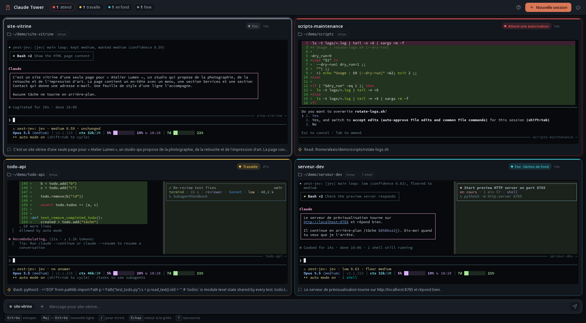
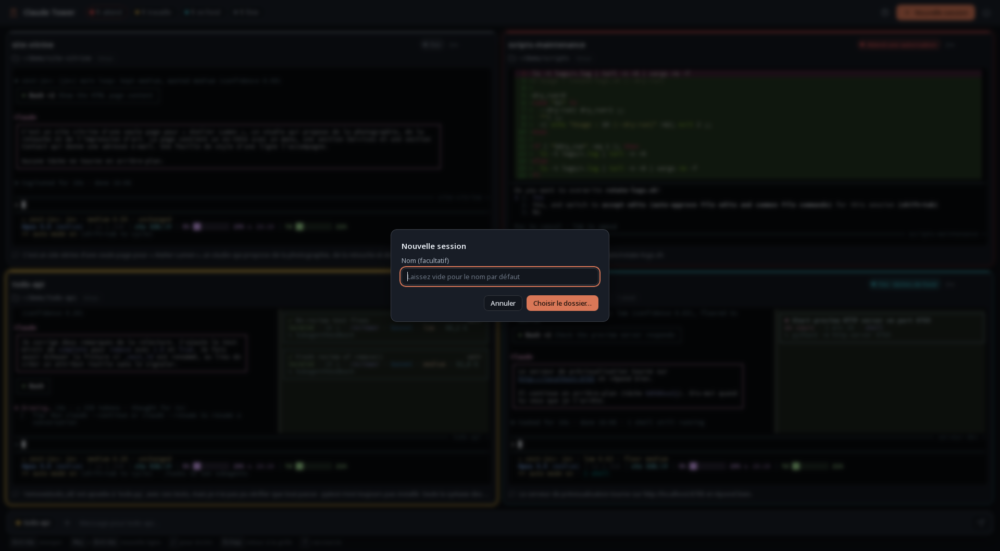
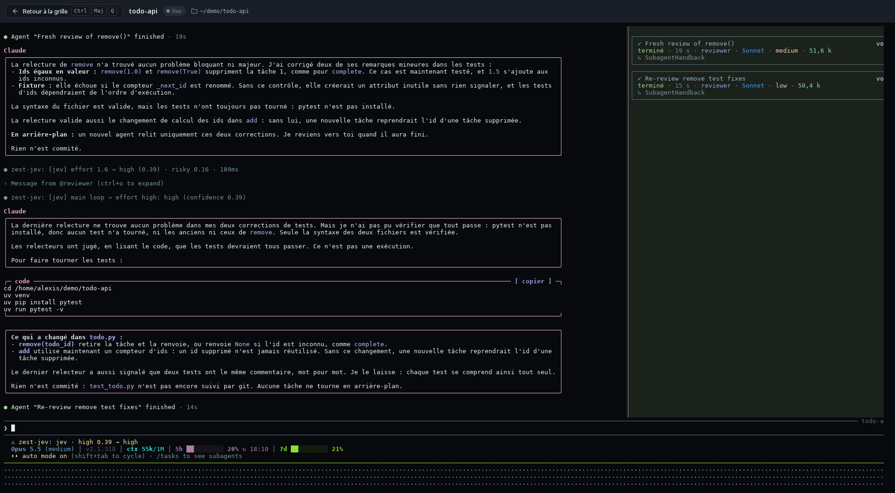
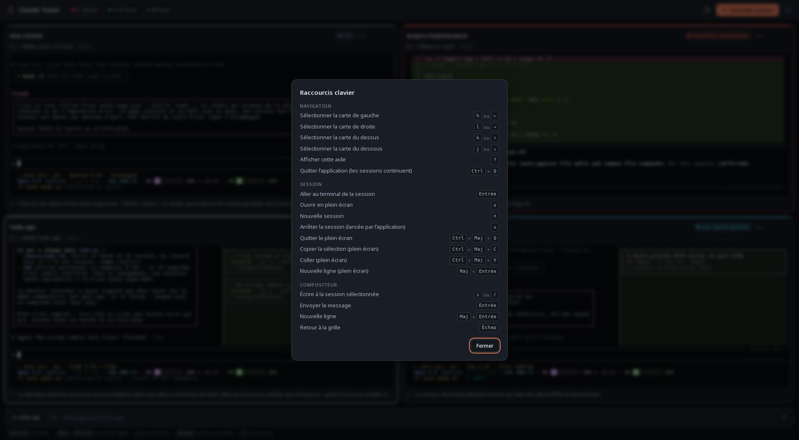

# Claude Tower

Une application de bureau (Linux et macOS) pour **voir et piloter d'un seul écran toutes les sessions Claude Code** qui tournent sur ta machine.

- **Mosaïque** : une carte par session, qui s'adapte au nombre de sessions et occupe toute la fenêtre. Le cadre de chaque carte prend la couleur de l'état de la session. La carte montre l'écran de la session en direct, panneau des tâches compris.
- **Compositeur** : la barre du bas envoie un message à la session sélectionnée, sans quitter l'application.
- **Aller à la session** : l'application bascule vers le terminal où la session est déjà affichée, ou l'ouvre en plein écran dans l'application.
- **Nouvelle session** : lance Claude dans le dossier de ton choix. La session tourne dans un serveur tmux privé et continue même si tu fermes l'application.



Tout est local : pas de serveur, pas de compte, pas de réseau. L'application lit le registre des sessions de Claude Code (`~/.claude/sessions/`), la fin des transcripts, et les serveurs tmux de ta session utilisateur.

## États

| Couleur | Signification |
| --- | --- |
| 🔴 rouge, halo pulsé | la session **attend ton intervention** (autorisation, question, dialogue) |
| 🟡 jaune | la session travaille (tour en cours ou commande shell) |
| 🔵 cyan | le tour est fini, mais des agents ou des shells tournent encore en arrière-plan |
| ⚪ gris | la session a fini et attend un nouveau message |
| gris pointillé | état non reconnu |

## Installation

L'application se construit sur le poste à partir du code source. Les étapes ci-dessous se font une seule fois ; pour une mise à jour, voir plus bas.

### 1. Prérequis pour l'utiliser

- **Claude Code**, installé et déjà connecté : `claude` doit s'ouvrir dans un terminal sans demander de connexion.
- **tmux 3.2 ou plus** : `tmux -V` affiche la version.

### 2. Outils pour la construire

Il faut Git, **Go 1.26.10 ou plus**, **Node 22.12 ou plus**, un compilateur C, et les bibliothèques GTK et WebKitGTK 4.1.

- **Fedora** (Fedora 44 ou plus ; sur une version plus ancienne, vérifie les versions ci-dessous) :
  ```sh
  sudo dnf install git golang nodejs npm gcc gtk3-devel webkit2gtk4.1-devel tmux
  ```
- **Debian ou Ubuntu** (Ubuntu 22.04 ou plus) : les paquets Go et Node de ces distributions sont trop anciens. Installe les bibliothèques par apt, puis Go et Node à part :
  ```sh
  sudo apt install git curl build-essential pkg-config libgtk-3-dev libwebkit2gtk-4.1-dev tmux
  ```
  - **Go** : télécharge l'archive Linux depuis [go.dev/dl](https://go.dev/dl/) et suis les instructions de la page (archive extraite dans `/usr/local/go`, puis `/usr/local/go/bin` ajouté au `PATH`).
  - **Node** : installe [nvm](https://github.com/nvm-sh/nvm#installing-and-updating), ouvre un nouveau terminal, puis lance `nvm install 22`.
- **macOS** : installe d'abord [Homebrew](https://brew.sh/) s'il n'est pas déjà là, en suivant les instructions affichées à la fin de son installation pour l'ajouter au `PATH`. Lance `xcode-select --install`, attends la fin de l'installation dans la fenêtre qui s'ouvre, puis :
  ```sh
  brew install go node tmux
  ```

Vérifie ensuite les versions :

```sh
go version   # go1.26.10 ou plus
node -v      # v22.12 ou plus
```

Si l'une est trop ancienne, installe Go depuis [go.dev/dl](https://go.dev/dl/), ou Node avec [nvm](https://github.com/nvm-sh/nvm#installing-and-updating) (`nvm install 22`).

Installe enfin le CLI Wails, qui construit l'application, et rends-le accessible en ajoutant son dossier au `PATH` dans le fichier de démarrage de ton shell (`~/.zshrc` pour zsh, le shell par défaut de macOS ; `~/.bashrc` pour bash) :

```sh
go install github.com/wailsapp/wails/v2/cmd/wails@v2.17.1
echo 'export PATH="$PATH:$(go env GOPATH)/bin"' >> ~/.zshrc   # ou ~/.bashrc
export PATH="$PATH:$(go env GOPATH)/bin"
wails version   # v2.17.1
```

### 3. Récupérer le code

```sh
git clone git@github.com:AlexisFinn/claude-tower.git
cd claude-tower
```

Sans clé SSH configurée sur GitHub, clone en HTTPS : `git clone https://github.com/AlexisFinn/claude-tower.git`.

### 4. Construire et installer

```sh
make install
```

La commande installe les dépendances de l'interface (`npm install`), construit l'application, puis l'installe :

- **Linux** : le binaire dans `~/.local/bin/claude-tower`, l'icône dans `~/.local/share/pixmaps/`, et un lanceur « Claude Tower » dans le menu des applications.
- **macOS** : `claude-tower.app` dans `/Applications`, et le lien `~/.local/bin/claude-tower`. L'application n'est pas signée : si macOS refuse de l'ouvrir, fais clic droit puis « Ouvrir », ou lance `xattr -dr com.apple.quarantine /Applications/claude-tower.app`. La première fois que tu vas à une session avec `Entrée`, macOS demande les autorisations « Automatisation » et « Accessibilité » : accepte-les pour que l'application puisse mettre ton terminal au premier plan.

`~/.local/bin` doit être dans le `PATH` pour les commandes `claude-tower run`, `list` et `bar`. Sinon, ajoute `export PATH="$HOME/.local/bin:$PATH"` à ton `~/.zshrc` ou `~/.bashrc`, puis ouvre un nouveau terminal.

### 5. Vérifier

1. `claude-tower list` répond, avec la liste des sessions Claude en cours, ou rien s'il n'y en a pas.
2. Lance « Claude Tower » depuis le menu des applications (Linux) ou le dossier Applications (macOS).
3. Ouvre `claude` dans un terminal : sa carte apparaît dans l'application en une seconde environ.
4. Dans l'application, `n` ouvre le dialogue de nouvelle session : choisis un dossier, et une carte « privée » apparaît, avec l'écran de Claude en direct.



### Mettre à jour

```sh
cd claude-tower
git pull
make install
```

Quitte puis relance l'application. Les sessions en cours ne sont pas touchées.

### Désinstaller

1. Arrête les sessions qui tournent dans le serveur tmux privé de l'application : ce sont les cartes marquées `privée`, lancées depuis l'application ou avec `claude-tower run`. Sélectionne chacune et appuie sur `x`. Ce serveur survit à l'application ; sans cet arrêt, ces sessions continueraient de tourner.
2. Retire l'alias `claude='claude-tower run'` de ton `~/.bashrc` ou `~/.zshrc` si tu l'as ajouté.
3. Depuis le dossier cloné :
   ```sh
   cd claude-tower
   make uninstall    # Linux : binaire, icône et lanceur ; macOS : l'application et le lien ~/.local/bin/claude-tower
   ```
   Si tu as installé avec un `PREFIX` différent (`make install PREFIX=…`), passe le même à `make uninstall`.
4. Supprime la configuration et le dossier du serveur privé :
   ```sh
   # Linux
   rm -rf ~/.config/claude-tower "${XDG_RUNTIME_DIR:-$HOME/.local/state}/claude-tower"
   # macOS
   rm -rf ~/Library/Application\ Support/claude-tower
   ```

### En cas de problème

- **`wails: command not found`** : le dossier `$(go env GOPATH)/bin` n'est pas dans le `PATH` (étape 2).
- **`wails doctor` signale que « libwebkit » manque** : c'est faux sur les systèmes qui n'ont que WebKitGTK 4.1 (Fedora 40 et plus). La construction passe quand même, avec le tag `webkit2_41` que le `Makefile` ajoute.
- **`go.mod requires go >= 1.26.10`** : Go est trop ancien. Installe-le depuis [go.dev/dl](https://go.dev/dl/) (étape 2).
- **Erreur de Vite ou de Node pendant `make install`** : Node est trop ancien (étape 2).
- **« claude introuvable : réglez claudeCommand dans … »** : l'application, lancée depuis le menu, ne voit pas `claude`. Indique son chemin complet (`command -v claude` dans un terminal) dans `claudeCommand` du fichier de configuration (voir [Configuration](#configuration)).
- **« tmux … est trop ancien »** : installe tmux 3.2 ou plus.
- **Les sessions de ton tmux n'apparaissent pas quand l'application est lancée depuis le menu** : si tu définis `TMUX_TMPDIR` dans ton shell, renseigne `tmuxTmpDir` dans la configuration.

## Utilisation

### Sessions visibles

| Session | Dans la carte | Compositeur | « Aller à la session » |
| --- | --- | --- | --- |
| lancée depuis l'application, ou avec `claude-tower run` | écran en direct | oui | plein écran intégré, ou terminal où elle est affichée |
| lancée dans ton propre tmux | écran en direct | oui | bascule ton terminal tmux et le met au premier plan (sous Wayland : plein écran intégré) |
| lancée hors tmux | dernière activité, en lecture seule | non | met la fenêtre du terminal au premier plan si possible |

En plein écran, la session s'affiche en grand dans l'application, et tu peux y taper comme dans un terminal. `Ctrl+Maj+Q` ramène à la grille.



### Sans tmux dans tes terminaux : `claude-tower run`

Si tu lances d'habitude `claude` directement, remplace la commande par `claude-tower run`. Elle accepte les mêmes arguments, transmis tels quels : `claude-tower run --resume`, `claude-tower run --model opus`…

Tu vois Claude dans ton terminal comme d'habitude, mais la session tourne dans le serveur privé de l'application, qui peut donc l'afficher et la piloter. Un alias permet de ne rien changer à tes habitudes :

```sh
alias claude='claude-tower run'
```

Fermer la fenêtre du terminal détache seulement la session : elle continue, et tu la retrouves dans l'application.

Dans ce terminal, la souris sert à défiler. Pour sélectionner du texte, maintiens `Maj` enfoncé.

### Raccourcis

| Touche | Action |
| --- | --- |
| `←` `↓` `↑` `→` ou `h` `j` `k` `l` | changer de carte |
| clic | sélectionner une carte |
| `Entrée` ou double-clic | aller à la session |
| `o` | ouvrir la session en plein écran dans l'application |
| `i` ou `/` | écrire dans le compositeur |
| bouton `+` (compositeur) | joindre des fichiers (ou les glisser sur la fenêtre) |
| `Entrée` (compositeur) | envoyer |
| `Maj+Entrée` (compositeur) | nouvelle ligne |
| `Échap` (compositeur) | revenir à la grille |
| `n` | nouvelle session |
| `x` | arrêter la session (seulement une session `privée`, lancée par l'application ou avec `claude-tower run`, ou une session `arrière-plan`) |
| `?` | liste des raccourcis |
| `Ctrl+Q` | quitter l'application (les sessions continuent) |
| `Ctrl+Maj+Q` (plein écran) | revenir à la grille |
| `Ctrl+Maj+C` et `Ctrl+Maj+V` (plein écran) | copier et coller |

`?` affiche la même liste dans l'application :



Le compositeur est désactivé quand la session attend une autorisation ou une réponse, pour éviter que ton message valide un choix par défaut. Réponds alors depuis le plein écran.

### En ligne de commande

- `claude-tower list` : liste des sessions en texte brut.
- `claude-tower bar` : segment pour la barre d'état tmux, par exemple `set -g status-right '#(~/.local/bin/claude-tower bar) '`.

### Configuration

`~/.config/claude-tower/config.json` (sous macOS : `~/Library/Application Support/claude-tower/config.json`) :

```json
{
  "claudeCommand": ["claude"],
  "tmuxTmpDir": "",
  "claudeConfigDir": ""
}
```

- `claudeCommand` : la commande qui lance Claude, avec ses arguments éventuels, par exemple `["claude", "--permission-mode", "auto"]`. Les alias du shell ne sont pas vus par l'application.
- `tmuxTmpDir` : à renseigner si tu définis `TMUX_TMPDIR` dans ton shell et que tu lances l'application depuis le menu du bureau.
- `claudeConfigDir` : le dossier de configuration de Claude Code, si ce n'est pas `~/.claude`.

## Limites

- **Format interne** : le registre des sessions est interne à Claude Code et peut changer à une mise à jour. Tout ce qui en dépend est dans `internal/registry`.
- **Wayland** : l'application ne peut pas mettre au premier plan la fenêtre d'une autre application. « Aller à la session » ouvre alors le plein écran intégré.
- **gnome-terminal** : comme toutes ses fenêtres appartiennent au même processus, c'est la première fenêtre trouvée qui passe au premier plan.
- **Secrets visibles** : les cartes affichent l'écran des sessions, commandes comprises. Ce qui y est écrit est visible.
- **Brouillon** : un brouillon déjà tapé dans le prompt de Claude part avec le message envoyé depuis le compositeur.
- **Sessions `run`** : elles survivent à leur terminal. Arrête-les depuis l'application (`x`).
- **macOS** : un PID réutilisé peut faire réapparaître brièvement une session morte.

## Checklist macOS (avant de partager)

1. `make install` réussit et l'application s'ouvre.
2. Les sessions Claude en cours apparaissent, et l'état « attend » s'affiche lors d'une demande d'autorisation.
3. `n` lance une session. Elle survit à la fermeture de l'application, et `x` l'arrête.
4. `claude-tower run` dans Terminal.app ou iTerm2 : la session apparaît, avec son écran en direct.
5. `Entrée` sur une session tmux met le terminal au premier plan (accepter les autorisations « Automatisation » et « Accessibilité » demandées).
6. Plein écran : frappe, `Maj+Entrée`, copier-coller, retour.
7. `tmux -V` vaut 3.2 ou plus, et `infocmp tmux-256color` ne renvoie pas d'erreur (sinon l'application utilise `screen-256color`).

## Développement

```sh
make test     # vet et tests Go, tests et typage du frontend
make build    # build/bin/claude-tower
wails dev -tags webkit2_41   # interface rechargée à chaud
```

- `make` lance Go avec `GOFLAGS=-mod=readonly`. Pour interdire tout téléchargement : `make test GO_ENV='GOPROXY=off GOFLAGS=-mod=readonly'`.
- Le plan d'implémentation est dans `PLAN.md`, et la direction visuelle dans `docs/DESIGN.md`.
- Les tests d'intégration démarrent de vrais serveurs tmux sur des sockets temporaires. Ils ne touchent jamais à tes sessions.
